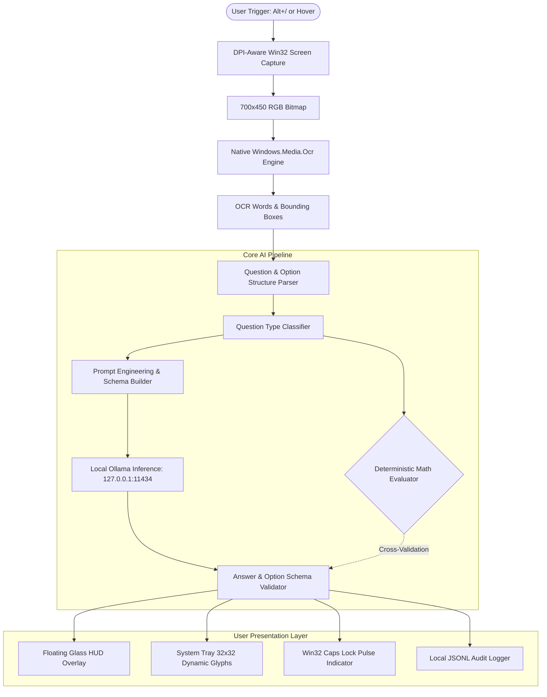

# Ghostline (Rubric-Local) — Architecture & Data Flow

Ghostline is a 100% offline, privacy-first desktop application designed for native Windows 10 and 11 environments. It enables seamless on-screen question capture, structure recognition, local LLM inference, deterministic mathematical cross-validation, and non-intrusive signaling.

---

## 1. High-Level System Architecture



---

## 2. Component Breakdown

### 2.1 Entry Points & Orchestration
- **[rubric_local/app.py](file:///rubric_local/app.py)** (`RubricApp`): The central lifecycle coordinator. Initializes UI subsystems, registers global low-level Windows keyboard hooks, spins up background task queues, and handles clean application shutdown.
- **[rubric_local/cli.py](file:///rubric_local/cli.py)**: Headless and diagnostic CLI interface supporting manual file OCR, benchmark inference, and health probes.

### 2.2 Screen Capture & Region Isolation
- **[rubric_local/core/capture.py](file:///rubric_local/core/capture.py)**: Utilizes Win32 GDI API (`BitBlt`, `CreateCompatibleDC`) with DPI-awareness (`SetProcessDpiAwarenessContext`). Dynamically captures a 700x450 pixel bounding box centered at the cursor, clamped to multi-monitor virtual screen bounds.
- **[rubric_local/core/capture_exclusion.py](file:///rubric_local/core/capture_exclusion.py)**: Registers HUD window HWNDs to prevent capturing Ghostline's own UI elements during active solves.
- **[rubric_local/core/hover_detector.py](file:///rubric_local/core/hover_detector.py)**: Low-overhead mouse stillness monitor running on a background thread. Detects when the user holds the pointer over a question for a configurable dwell threshold (default: 800ms).

### 2.3 Native Windows OCR Engine
- **Binary:** `bin/win_ocr.exe` (compiled from [bin/src/WinOcr.cs](file:///bin/src/WinOcr.cs)).
- **Mechanism:** Integrates directly with Windows 10/11 native `Windows.Media.Ocr.OcrEngine` using UWP/WinRT APIs. 
- **Benefits:**
  - Zero external OCR runtimes (no Tesseract DLLs or Python-tesseract wrappers).
  - Sub-40ms execution time.
  - Zero terminal flash (`CREATE_NO_WINDOW | STARTF_USESHOWWINDOW`).
- **[rubric_local/core/ocr_engine.py](file:///rubric_local/core/ocr_engine.py)**:
  - Line normalization and inline option splitting (`A) ... B) ...`).
  - Label extraction supporting `A-D`, `1-4`, Roman numerals `(i)-(iv)`, True/False, and bulleted lists.
  - OCR noise cleanup that preserves mathematical symbols (`^`, `*`, `/`, `%`, `+`, `-`) and code indentation.

### 2.4 Local Inference & Mathematical Reasoning
- **[rubric_local/core/llm_client.py](file:///rubric_local/core/llm_client.py)**:
  - Communicates strictly with `http://127.0.0.1:11434` (Ollama local REST API).
  - Default Model: `phi3:mini` (3.8B parameters, 2.2GB, Q4_K_M).
  - Low-VRAM Fallback: `qwen2.5:0.5b` (0.5B parameters, 397MB).
  - **Deterministic AST Math Solver:** Parses standard arithmetic expressions (`25 * 4 - 30 / 2`, `17 % 5 + 2 * 3^2`) and linear equations (`ax + b = c`) using Python's restricted `ast` module. Cross-validates or overrides LLM calculations with 100% mathematical precision.
  - **Structured Prompts:** Type-aware prompting tailored for Multiple-Choice, True/False, Numerical calculations, Programming, and Technical Theory.

### 2.5 Two-Pass Validation & Hallucination Defense
- Rejects ungrounded LLM ramblings, multi-choice options not present in the captured image, and arbitrary hallucinations.
- Maps option text back to canonical keys if the LLM responds with option content instead of label tokens.
- Emits structured `AnswerResult` instances with calibrated confidence scores, validation metadata, and diagnostic telemetry.

### 2.6 Presentation Subsystems
- **Floating HUD (`hud_overlay.py`):** Translucent borderless Tkinter window configured with `WS_EX_TOPMOST` and `WS_EX_NOACTIVATE` to avoid stealing keyboard focus from active assessment applications. Supports dragging, minimization, syntax-highlighted code rendering, and clipboard actions.
- **System Tray (`tray_indicator.py`):** Renders dynamic 32x32 pixel PIL icons displaying validated option numbers or letters (`1`, `2`, `A`, `B`), `Code`, `T`/`F`, or uncertainty glyphs (`?`, `!`).
- **Caps Lock Pulses (`caps_indicator.py`):** Win32 keyboard pulse signaling (`1` pulse = A / 1, `2` pulses = B / 2, etc.) with automatic atomic state restoration to ensure Caps Lock returns to its pre-solve physical state.

---

## 3. Threading & Synchronization Model

```
[ Tkinter Main Thread ]  <---> [ Queue.Queue ] <---> [ Background Worker Thread ]
  - UI Event Loop                                        - Win32 Screen Grab
  - HUD Drawing & Layout                                 - Native OCR Subprocess
  - Tray Icon Updates                                    - Local Ollama HTTP Post
  - Diagnostics Rendering                                - Math AST Evaluation
                                                         - Answer Validation
```

All OS-level hooks, subprocess executions, and network requests to localhost Ollama execute asynchronously off the UI thread to guarantee 60fps responsiveness without freezing desktop interactions.
